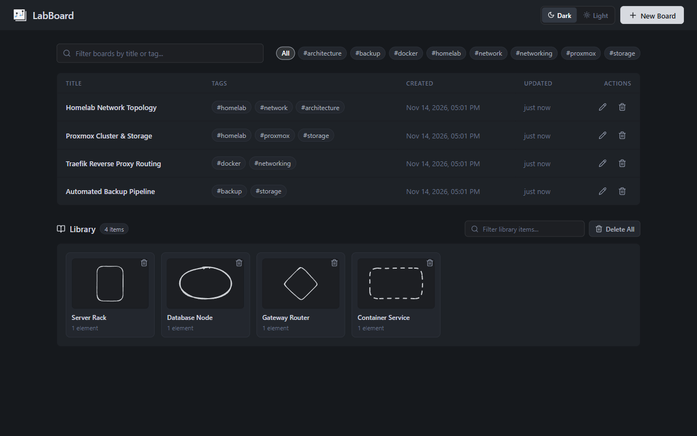
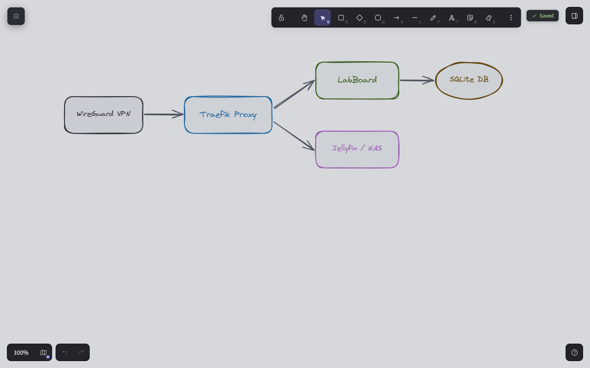

# LabBoard

<p align="center">
  
</p>

<p align="center">
  <strong>Self-hosted Excalidraw workspace built for your homelab.</strong><br />
  Create, organize, tag, and auto-save diagrams with a shared SQLite-backed shape library.<br />
  Packaged as a single, dependency-free Go binary with embedded React assets — no accounts, no cloud telemetry, no fluff.
</p>

<p align="center">
  <a href="LICENSE"></a>
  <a href="https://github.com/saintedlama/labboard/actions/workflows/ci.yml"></a>
  <a href="https://github.com/saintedlama/labboard/pkgs/container/labboard"></a>
  <a href="go.mod"></a>
  <a href="https://excalidraw.com"></a>
</p>

<p align="center">
  <a href="#-why-labboard">✨ Why LabBoard?</a> •
  <a href="#-what-labboard-is-not">🚫 What It's Not</a> •
  <a href="#-quickstart">⚡ Quickstart</a> •
  <a href="#-features">🎨 Features</a> •
  <a href="#️-architecture">🏛️ Architecture</a> •
  <a href="#️-configuration--api">⚙️ Config & API</a> •
  <a href="#️-development">🛠️ Development</a>
</p>

---





---

## ✨ Why LabBoard?

Excalidraw is unbeatable for sketching system architectures, network topologies, and quick RFC diagrams. Out of the box, however, the standard self-hosted Excalidraw frontend stores scenes ephemerally in browser `localStorage` — switching machines, clearing site data, or trying to organize dozens of homelab diagrams quickly turns into file juggling.

LabBoard wraps the official `@excalidraw/excalidraw` editor in a fast, zero-dependency workspace backed by SQLite:

- 💾 **Real Persistence on Disk** — Every board, canvas state, embedded image, and scene update auto-saves cleanly to a single SQLite database (`WAL` mode) rather than volatile browser storage.
- 🏷️ **Search & Tag Organization** — Filter boards by title or `#tag` chips so network maps, Proxmox layouts, and architecture sketches stay one click away.
- 📚 **Shared Diagram Library** — Import or add `.excalidrawlib` shapes once and reuse them across every board and browser, with a visual thumbnail gallery on the dashboard.
- 🌗 **Dark & Light Modes** — Monochrome **One Dark Pro Night Flat** dark theme and crisp light theme, synced bidirectionally with the Excalidraw canvas.
- 📦 **Single Dependency-Free Binary** — Frontend assets are compiled and embedded directly into one Go executable (`embed.FS`) using a pure-Go SQLite driver (`modernc.org/sqlite`) — no CGO, Redis, Postgres, or external services.

---

## 🚫 What LabBoard is NOT

LabBoard is intentionally focused and small. By design, it is **not**:

- **A real-time multiplayer whiteboard** — There are no WebSocket rooms, CRDT sync servers, or live multi-cursor sessions. LabBoard is built for fast, dependable single-operator and homelab documentation.
- **An authentication or multi-tenant platform** — There are no user accounts, RBAC, or login walls. Bind to `127.0.0.1` locally, or place LabBoard behind Tailscale, WireGuard, Authelia, or your reverse proxy's auth when exposing it on a network.
- **A fork of Excalidraw's canvas** — LabBoard embeds the upstream `@excalidraw/excalidraw` React package directly rather than maintaining a custom drawing engine.

---

## ⚡ Quickstart

### Option 1: Docker (Fastest)

Run LabBoard with a persistent `/data` volume for the SQLite database:

```bash
docker run -d \
  --name labboard \
  -p 8080:8080 \
  -v labboard-data:/data \
  ghcr.io/saintedlama/labboard:latest
```

Open **`http://localhost:8080`** in your browser.

<details>
<summary><b>Using Docker Compose? Click for <code>compose.yml</code></b></summary>

```yaml
services:
  labboard:
    image: ghcr.io/saintedlama/labboard:latest
    container_name: labboard
    restart: unless-stopped
    ports:
      - "8080:8080"
    volumes:
      - ./data:/data
    environment:
      - HOST=0.0.0.0
      - PORT=8080
      - DATA_DIR=/data
      - DB_NAME=labboard.db
```

Start the service:

```bash
docker compose up -d
```

</details>

### Option 2: Build from Source

Requires **Go 1.27+** and **Node.js 22+** with Corepack enabled:

```bash
git clone https://github.com/saintedlama/labboard.git
cd labboard

# 1. Build the React frontend into frontend/dist
cd frontend
corepack enable
pnpm install --frozen-lockfile
pnpm run build
cd ..

# 2. Build and run the single binary
go build -ldflags="-s -w" -o labboard ./cmd/labboard
./labboard
```

Open **`http://127.0.0.1:8080`** in your browser.

---

## 🎨 Features

- **Boards Dashboard** — Create, rename, tag, search, and delete boards from a clean tabular overview.
- **Debounced Auto-Save** — Canvas edits, viewport/app state changes, and embedded assets sync automatically to the backend with live `Saved` / `Saving...` feedback.
- **Quick Export & Actions Toolbar** — Export scenes as **PNG** or **SVG** directly from the editor toolbar (`Ctrl+S`), toggle grid/zen/view modes, or clear/reset the canvas with confirmation dialogs.
- **Theme Sync** — Switching between **Dark** (`#16191d` Night Flat) and **Light** updates both the application chrome and Excalidraw's canvas, whether triggered from the dashboard toggle, the editor burger menu, or Excalidraw's command palette.
- **Unified Library Gallery** — Browse saved `.excalidrawlib` items directly on the home page with dynamic dark/light thumbnail previews and one-click deletion.

---

## 🏛️ Architecture

```
┌─────────────────────────────────────────────────────────────┐
│                      LabBoard Binary                        │
│                                                             │
│  ┌───────────────────────┐       ┌───────────────────────┐  │
│  │     React Frontend    │       │       Go Backend      │  │
│  │ (Embedded Static SPA) │       │                       │  │
│  │                       │ HTTP  │  • Static File Server │  │
│  │  • Boards Dashboard   │◄─────►│  • REST API Engine    │  │
│  │  • Shared Library UI  │ JSON  │  • SQLite Persistence │  │
│  │  • Excalidraw Editor  │       │                       │  │
│  └───────────────────────┘       └──────────┬────────────┘  │
└─────────────────────────────────────────────┼───────────────┘
                                              ▼
                                   ┌─────────────────────┐
                                   │ SQLite DB (WAL Mode)│
                                   │     labboard.db     │
                                   └─────────────────────┘
```

| Layer | Technology | Rationale |
|---|---|---|
| **Backend** | Go (`net/http`) | Single compiled executable, sub-second startup, tiny memory footprint |
| **Database** | SQLite (`modernc.org/sqlite`) | Pure-Go driver (`CGO_ENABLED=0`), single-file ACID persistence in WAL mode |
| **Frontend** | React 19, TypeScript, Vite | Embedded via `//go:embed all:dist` with immutable cache headers |
| **Canvas Engine** | `@excalidraw/excalidraw` | Official Excalidraw React component and `.excalidrawlib` library format |

---

## ⚙️ Configuration & API

LabBoard loads configuration from CLI flags, environment variables, and `.env` files in the following precedence (highest to lowest):

1. **CLI flags** (`-host`, `-port`, `-data-dir`, `-db-name`, `-env`)
2. **Environment variables** (`HOST`, `PORT`, `DATA_DIR`, `DB_NAME`, `LABBOARD_ENV_FILE`)
3. **`.env` file** (automatically loaded from `.env` in the working directory if present)
4. **Defaults**

| Option | Flag | Env Variable | Default | Description |
|---|---|---|---|---|
| Host | `-host` | `HOST` | `127.0.0.1` | Interface to bind (`0.0.0.0` for LAN/Docker access) |
| Port | `-port` | `PORT` | `8080` | HTTP server listen port |
| Data Directory | `-data-dir` | `DATA_DIR` | `./data` | Directory where the SQLite database file is stored |
| Database Name | `-db-name` | `DB_NAME` | `labboard.db` | SQLite database filename |
| Env File | `-env` | `LABBOARD_ENV_FILE` | `.env` | Path to custom `.env` file |

<details>
<summary><b>🔌 REST API Reference</b></summary>
<br />

| Method | Path | Description |
|---|---|---|
| `GET` | `/api/health` | Health check (`{"status":"ok"}`) |
| `GET` | `/api/boards` | List boards (supports optional `?tag=` and `?q=` filters) |
| `POST` | `/api/boards` | Create a new board (`title`, `tags`, optional initial `data`) |
| `GET` | `/api/boards/{id}` | Retrieve board metadata and full Excalidraw scene JSON |
| `PUT` | `/api/boards/{id}` | Update board `title`, `tags`, or `data` |
| `DELETE` | `/api/boards/{id}` | Delete a board |
| `GET` | `/api/library` | Retrieve the shared Excalidraw library items |
| `PUT` | `/api/library` | Replace/save the shared Excalidraw library items |

</details>

<details>
<summary><b>🎨 Theme & Color Palette</b></summary>
<br />

LabBoard pairs a **One Dark Pro Night Flat** dark palette (`#16191d` canvas, `#1e2227` surfaces, `#d7dae0` / `#abb2bf` text) with a clean monochrome light palette (`#f6f7f9` canvas, `#ffffff` surfaces, `#111827` / `#374151` text). All semantic CSS tokens are defined in [`frontend/src/styles/theme.css`](frontend/src/styles/theme.css).

</details>

---

## 🛠️ Development

### Directory Structure

```
labboard/
├── cmd/
│   └── labboard/         # Go application entrypoint
├── internal/
│   ├── api/              # HTTP handlers, SPA static server, REST endpoints
│   ├── config/           # CLI flag, env var, and .env configuration loader
│   ├── db/               # SQLite WAL setup, schema migrations, CRUD
│   └── models/           # Shared JSON/API data models
├── frontend/             # React + TypeScript + Vite workspace
│   ├── public/           # Generated favicons and touch icon
│   └── src/
│       ├── api/          # Backend REST API client
│       ├── assets/       # Brand logo SVG
│       ├── components/   # BoardsList, BoardEditor, LibrarySection, ConfirmDialog
│       ├── styles/       # Theme tokens and monochrome component styles
│       └── utils/        # Theme storage & Excalidraw helpers
├── Dockerfile            # Multi-stage static frontend + pure-Go runtime build
├── .env.example          # Example environment configuration
└── .invincible.toml      # Local dev process orchestration
```

### Developing with Invincible

Use [Invincible](https://github.com/saintedlama/invincible) to run the Go API server (`:8080`) with file-watch rebuilds alongside the Vite HMR dev server (`:5173`):

```bash
invincible
```

Or run both manually in separate terminals:

```bash
# Terminal 1: Go backend
go run ./cmd/labboard

# Terminal 2: Vite frontend dev server
cd frontend && corepack pnpm dev
```

### Verification

```bash
# Frontend typecheck & build
cd frontend && corepack pnpm exec tsc --noEmit && corepack pnpm run build && cd ..

# Go checks & tests
gofmt -l .
go vet ./...
go test -race ./...
```

---

## 🤝 Contributing & Community

Contributions, bug reports, and feature ideas are welcome!

- Read [CONTRIBUTING.md](CONTRIBUTING.md) before opening a pull request.
- Please follow our [Code of Conduct](CODE_OF_CONDUCT.md).
- To report a security vulnerability privately, see [SECURITY.md](SECURITY.md).

---

## 📄 License

LabBoard is open-source software licensed under the [MIT License](LICENSE).
